

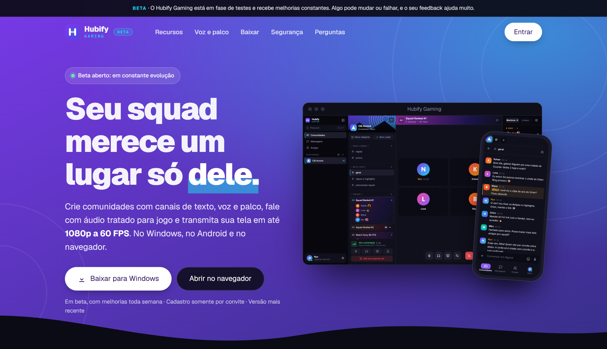

# Hubify Gaming

**Comunidades, voz e transmissão para quem joga.**
Canais de texto, voz e palco, apertar para falar, transmissão do jogo em até 1080p/60 FPS e segurança levada a sério.

> **Beta.** O Hubify Gaming está em fase de testes e recebe melhorias constantes. Já dá para usar no dia a dia, mas funções podem mudar ou falhar pelo caminho. Achou algo estranho? [Abra uma issue](https://github.com/andreygiordane/hubify-gaming-releases/issues/new/choose): isso ajuda a corrigir mais rápido.

---

## Baixar

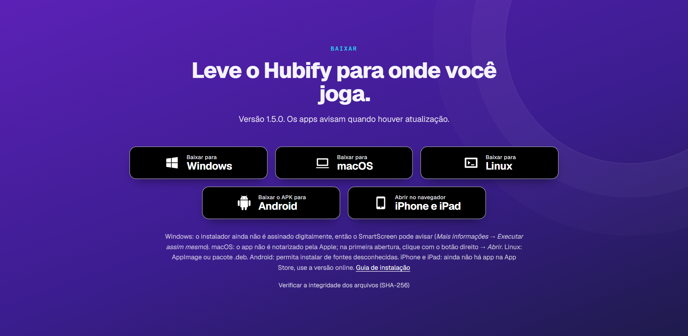

| Plataforma | Como obter | Guia |
|---|---|---|
| **Windows 10/11** | [`Hubify-Gaming-Setup-X.Y.Z.exe`](https://github.com/andreygiordane/hubify-gaming-releases/releases/latest) | [Instalar no Windows](docs/INSTALACAO.md#windows) |
| **Android** | [`Hubify-Gaming-X.Y.Z.apk`](https://github.com/andreygiordane/hubify-gaming-releases/releases/latest) | [Instalar no Android](docs/INSTALACAO.md#android) |
| **iPhone e iPad** | Abra [hubify.site/entrar](https://hubify.site/entrar) no Safari | [Usar no iPhone/iPad](docs/INSTALACAO.md#iphone-e-ipad) |
| **Navegador** | [hubify.site/entrar](https://hubify.site/entrar) | Nada para instalar |
| **macOS** | [`.dmg`](https://github.com/andreygiordane/hubify-gaming-releases/releases/latest) (Apple Silicon e Intel) | [Instalar no macOS](docs/INSTALACAO.md#macos) |
| **Linux** | [`.AppImage` ou `.deb`](https://github.com/andreygiordane/hubify-gaming-releases/releases/latest) | [Instalar no Linux](docs/INSTALACAO.md#linux) |

Este repositório guarda **só os instaladores e a documentação** (o código-fonte é privado). Confira a integridade do arquivo com o `SHA256SUMS.txt` de cada versão: [como verificar](docs/INSTALACAO.md#verificar-o-arquivo-sha-256).

> O acesso é **somente por convite**. Peça o link a quem administra a sua comunidade (formato `hubify.site/?convite=CÓDIGO`).

---

## Documentação

> Prefere ler no site? A **[Documentação online](https://hubify.site/site/documentacao.html)** traz o essencial e a **segurança explicada em detalhes** (2FA, criptografia de ponta a ponta, o que é e não é protegido). Aqui no GitHub você encontra tudo em páginas separadas:

| Comece por aqui | Aprofunde |
|---|---|
| 🚀 [**Primeiros passos**](docs/COMECANDO.md): convite, cadastro e a primeira comunidade | 🛡️ [**Segurança**](docs/SEGURANCA.md): 2FA, criptografia de ponta a ponta e o que cada uma cobre |
| 💾 [**Instalação**](docs/INSTALACAO.md): Windows, Android, iPhone/iPad, verificação do arquivo | 🔏 [**Privacidade (LGPD)**](docs/PRIVACIDADE.md): o que guardamos, por quê e seus direitos |
| 🏘️ [**Comunidades**](docs/COMUNIDADES.md): canais, cargos, convites, moderação | 🔄 [**Atualizações**](docs/ATUALIZACOES.md): como o app se atualiza (e o que é automático) |
| 🎙️ [**Voz e transmissão**](docs/VOZ-E-TRANSMISSAO.md): salas de voz, palco, tela em 1080p | ❓ [**Perguntas frequentes**](docs/FAQ.md) e 🧰 [**Solução de problemas**](docs/SOLUCAO-DE-PROBLEMAS.md) |
| 💬 [**Mensagens e amigos**](docs/MENSAGENS-E-AMIGOS.md): DMs, amigos e criptografia | 📜 [**Histórico de versões**](docs/CHANGELOG.md) |

---

## O que você encontra

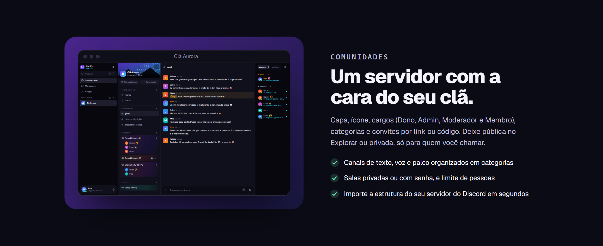

 

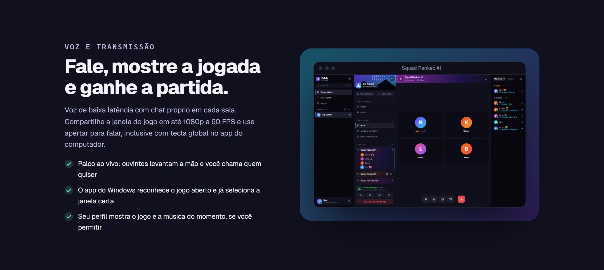

### Em resumo
- **Comunidades** com capa, ícone, cargos (Dono, Admin, Moderador e Membro), categorias e convites por link ou código; públicas no Explorar ou privadas.
- **Canais de texto, voz e palco**, com chat próprio em cada sala de voz, limite de pessoas, salas privadas ou com senha e arrastar e soltar para organizar.
- **Voz de baixa latência** com apertar para falar (global no app do Windows) e **transmissão do jogo** em até 1080p a 60 FPS.
- **Status automático e opcional** no app do Windows: o jogo que você joga (com a capa) e a música que ouve.
- **Mensagens diretas** com **criptografia de ponta a ponta**, amigos com código e perfil gamer.
- **Importar a estrutura do seu servidor do Discord** por modelo (cargos, categorias, canais e permissões).

### Em telas

<table>
  <tr>
    <td width="50%">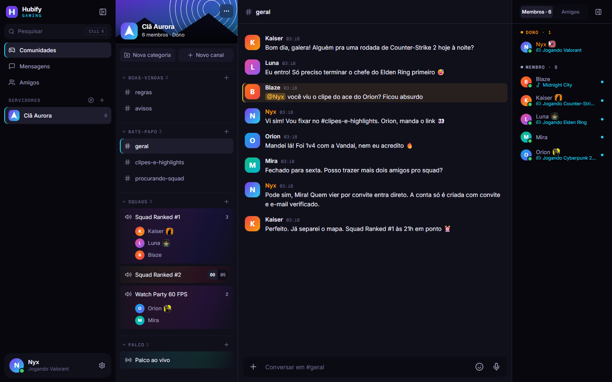 <b>Comunidade</b>: canais, categorias, voz e membros lado a lado.</td>
    <td width="50%">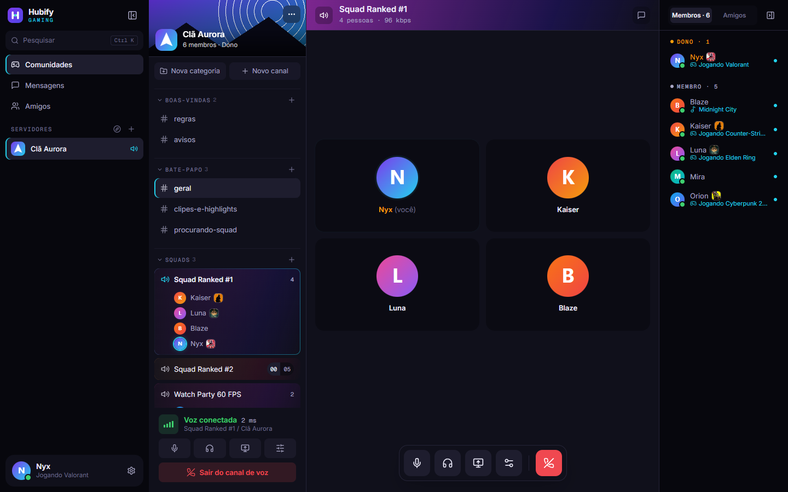 <b>Voz</b> em tempo real, com o jogo de cada pessoa ao lado do nome.</td>
  </tr>
  <tr>
    <td>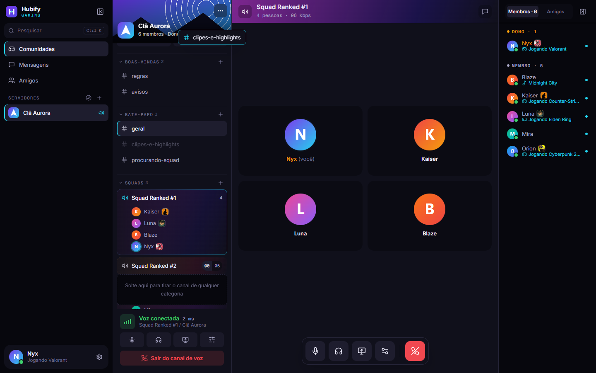 <b>Arraste e solte</b> canais entre categorias.</td>
    <td>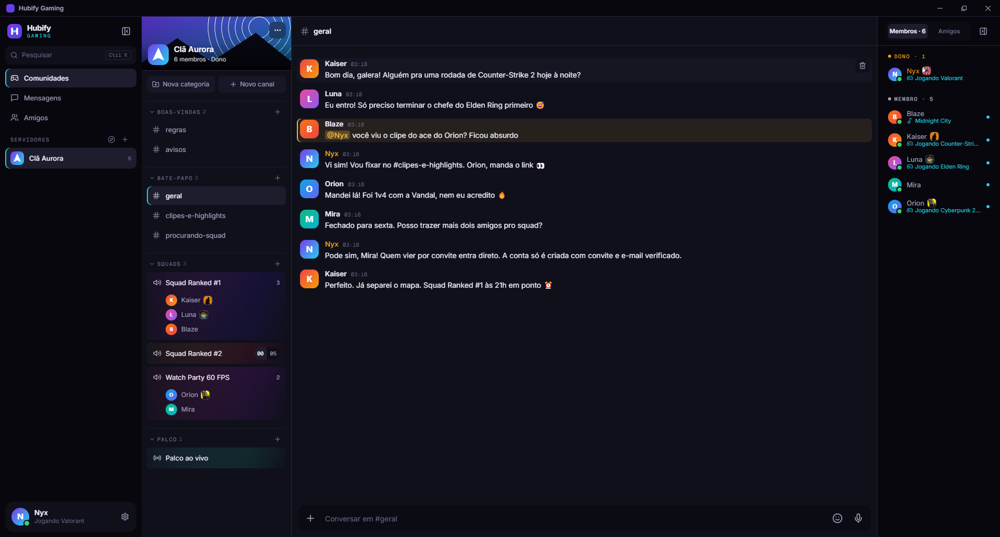 <b>App para Windows</b>: barra própria, bandeja do sistema e atualização automática.</td>
  </tr>
</table>

<table>
  <tr>
    <td align="center" width="25%">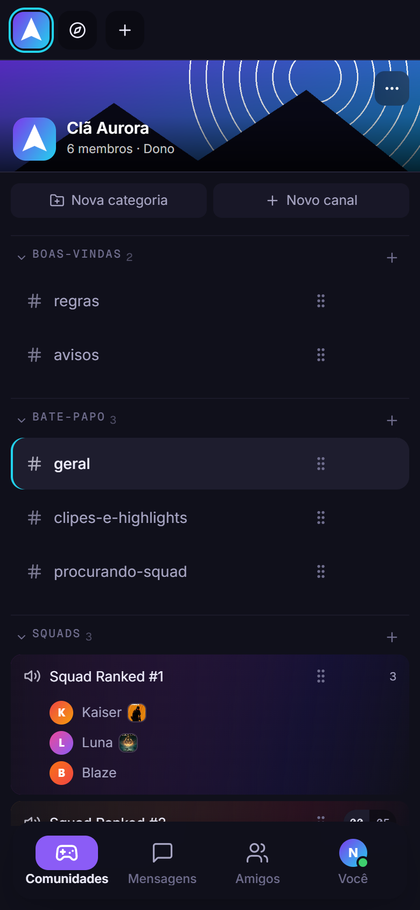 Canais</td>
    <td align="center" width="25%">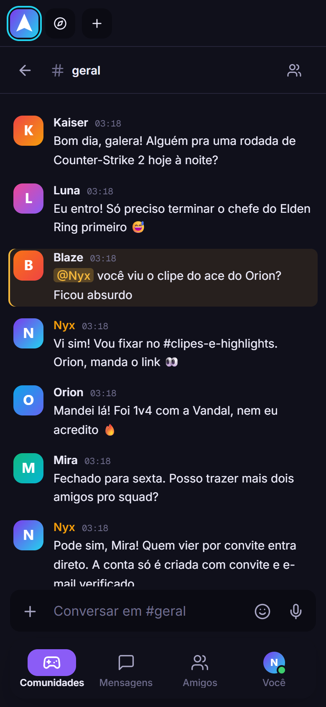 Chat</td>
    <td align="center" width="25%">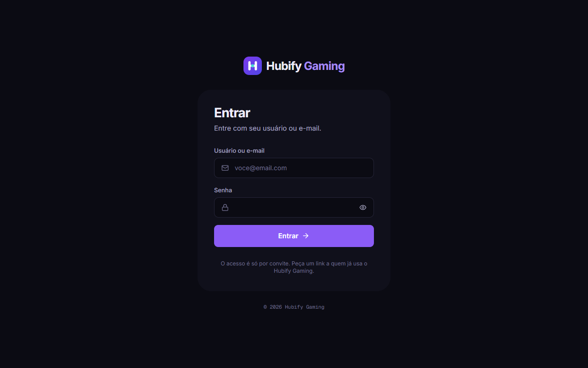 Entrar</td>
    <td align="center" width="25%">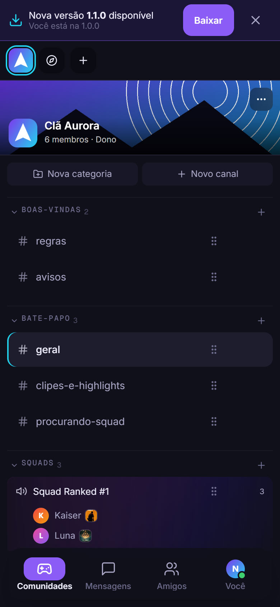 Atualização</td>
  </tr>
</table>

As imagens usam **dados fictícios** (usuários, mensagens e comunidade de demonstração).

---

## Segurança em poucas linhas

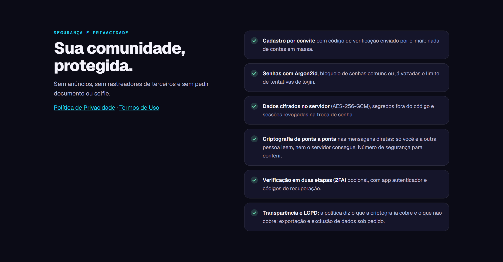

- **Cadastro só por convite**, com código de 6 dígitos por e-mail.
- **Verificação em duas etapas (2FA)**, opcional, com app autenticador e códigos de recuperação.
- **Criptografia de ponta a ponta nas mensagens diretas**: só você e a outra pessoa leem; nem o servidor consegue. Com **número de segurança** para conferir.
- **Senhas com Argon2id**, bloqueio de senhas comuns ou vazadas e limite de tentativas.
- **Dados cifrados no servidor** (AES-256-GCM) e segredos fora do código.
- **Transparência:** o que a criptografia cobre **e o que não cobre** está dito com todas as letras em [Segurança](docs/SEGURANCA.md#o-que-é-protegido-e-o-que-não-é).

Encontrou uma vulnerabilidade? Leia a [política de segurança](SECURITY.md) e **não** publique os detalhes em uma issue aberta.

---

Hubify Gaming · <a href="https://hubify.site">hubify.site</a> · <a href="docs/CHANGELOG.md">versões</a> · <a href="docs/PRIVACIDADE.md">privacidade</a> · <a href="SECURITY.md">segurança</a> Nomes e capas de jogos pertencem aos seus titulares. O Hubify Gaming não é afiliado a nenhuma empresa de jogos.

