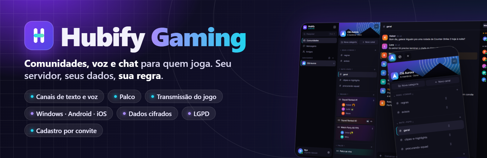
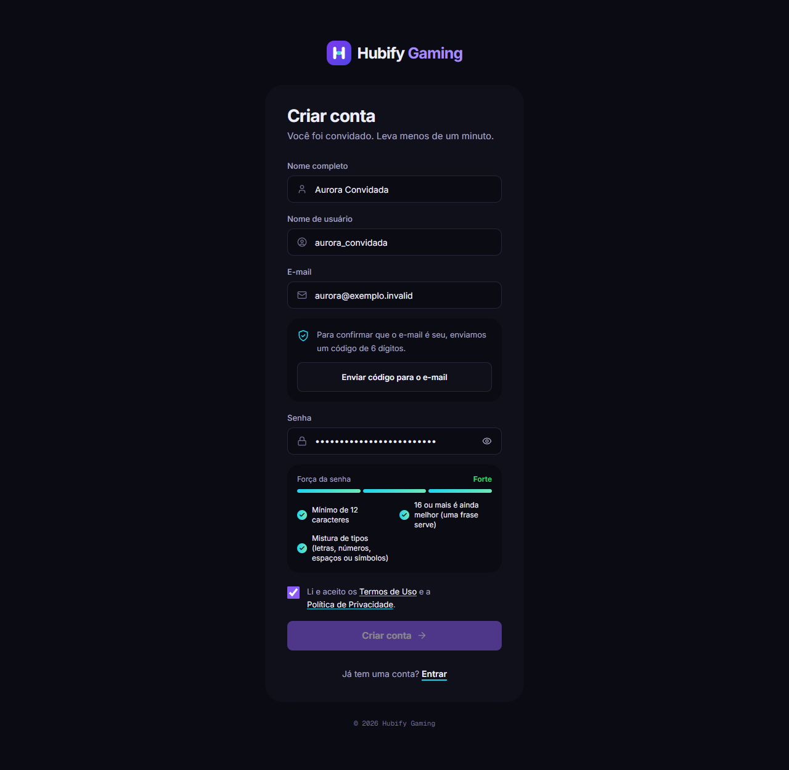
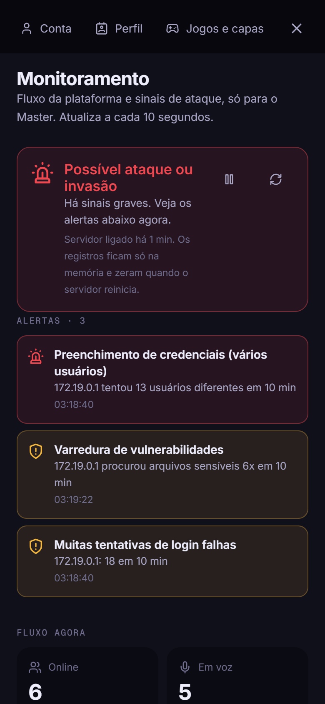
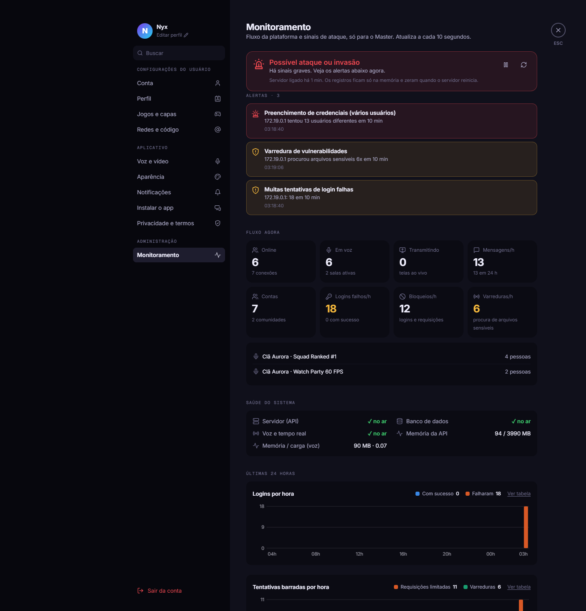

<div align="center">



**Comunidades, voz e chat para quem joga.**
Canais de texto e voz, palco, transmissão do jogo, status automático do que você joga e ouve, apps para Windows e Android e segurança levada a sério.

[](https://github.com/andreygiordane/hubify-gaming-releases/releases/latest)


<sub>Imagens com <b>dados fictícios</b> (usuários, mensagens e comunidade de demonstração, já apagados do servidor).</sub>

</div>

---

## Baixar

Este repositório guarda **só os instaladores** (o código-fonte é privado). Pegue a versão mais recente em **[Releases](https://github.com/andreygiordane/hubify-gaming-releases/releases/latest)**.

| Plataforma | Arquivo | Como instalar |
|---|---|---|
| **Windows** | `Hubify-Gaming-Setup-X.Y.Z.exe` | Execute. Se o Windows mostrar o aviso do SmartScreen (o instalador ainda não é assinado digitalmente), clique em *Mais informações > Executar assim mesmo*. |
| **Android** | `Hubify-Gaming-X.Y.Z.apk` | Baixe e permita instalar de fontes desconhecidas. |
| **iOS** | PWA | No Safari, abra o endereço do servidor e use *Compartilhar > Adicionar à Tela de Início*. |

**Confira o arquivo** (recomendado): compare com o `SHA256SUMS.txt` da Release.
```powershell
certutil -hashfile Hubify-Gaming-Setup-1.2.0.exe SHA256
```

**Atualização automática.** Quando sai uma versão nova aqui, o app para Windows e o app Android avisam sozinhos. O app do Windows só instala se o SHA-256 do instalador conferir com o `SHA256SUMS.txt`; se não conferir, recusa.

> O acesso à plataforma é **somente por convite**. Peça o link a quem administra a sua comunidade.

---

## O que você encontra

<table>
  <tr>
    <td width="50%"><br><sub><b>Voz</b> em tempo real, com o jogo de cada pessoa ao lado do nome.</sub></td>
    <td width="50%"><br><sub><b>Arraste e solte</b> canais entre categorias (texto com texto, voz com voz).</sub></td>
  </tr>
  <tr>
    <td><br><sub><b>App para Windows</b>: barra própria, bandeja do sistema e atualização automática.</sub></td>
    <td><br><sub><b>Cadastro</b>: convite + código de 6 dígitos por e-mail + aceite dos termos.</sub></td>
  </tr>
</table>

<table>
  <tr>
    <td align="center" width="25%"><br><sub>Canais</sub></td>
    <td align="center" width="25%"><br><sub>Chat</sub></td>
    <td align="center" width="25%"><br><sub>Monitoramento (Master)</sub></td>
    <td align="center" width="25%"><br><sub>Aviso de atualização</sub></td>
  </tr>
</table>

### Recursos
- **Comunidades** públicas ou privadas, com capa, ícone, **convites** (permanentes ou temporários; gerar um novo código invalida o anterior na hora) e **cargos e permissões**.
- **Canais de texto, voz e palco**, com **categorias de verdade** (renomeie, crie e apague todas) e **arrastar e soltar** no mouse e no toque. Menções com `@`, figurinhas, salas privadas ou com senha, chat em toda sala de voz.
- **Voz** com apertar para falar (global no app para Windows) e **transmissão do jogo** até 1080p a 60 FPS (no Windows só a janela do jogo, nunca a tela inteira).
- **Status automático (opcional, com permissão):** o jogo que você está jogando (Steam, Epic, GOG...) com a **capa ao lado do seu nome**, e a música que está ouvindo (Spotify, YouTube, YouTube Music, Apple Music, Deezer, SoundCloud...). Só de fontes de música/vídeo conhecidas.
- **Mensagens diretas**, amigos e perfil gamer.
- **Painel de monitoramento** para a conta Master, com fluxo em tempo real e alertas de ataque.

<div align="center"><br><sub>Monitoramento (só o Master): status, alertas, fluxo, saúde do sistema e gráficos.</sub></div>

---

## Segurança

- **Cadastro só por convite**, com **código de 6 dígitos enviado por e-mail** (vale 10 minutos, uso único).
- **Dados cifrados** no servidor com **AES-256-GCM**; **senhas com Argon2id**; política que recusa senhas comuns e as que **já vazaram** em invasões.
- **Segredos fora do código**, em cofre criptografado pelo sistema operacional.
- **Sessões revogadas** quando a senha é trocada; limites de tentativas de login; cabeçalhos de segurança; containers isolados.
- **Detecção de ataques** (força bruta, varredura, sessão forjada, dado adulterado...) no painel do Master.
- **Atualizações verificadas** por SHA-256.

**O que ainda não existe:** verificação em duas etapas (2FA) e criptografia ponta a ponta das mensagens diretas (estão nos próximos passos).

## Privacidade e LGPD

O app traz a **Política de Privacidade** e os **Termos de Uso** em *Configurações > Privacidade e termos*, e a conta só é criada com o aceite deles.

- **Não vendemos nem alugamos dados** e não usamos publicidade nem rastreadores de terceiros.
- Jogo e música no perfil são **opcionais** e só funcionam com a sua permissão. O app lê apenas o nome do programa e o título/artista que o Windows já mostra; **nada é lido de dentro do jogo**.
- Registros técnicos de segurança (IP e tentativas) ficam **só na memória do servidor**, por até 7 dias.
- **Seus direitos (LGPD, art. 18):** acesso, correção, eliminação, portabilidade e revogação do consentimento. Peça pelo contato informado na Política.
- Destinado a maiores de 14 anos; menores de 18 com autorização do responsável.

## Compatibilidade com anti-cheats

O app **não injeta código, não desenha sobre o jogo e não lê a memória** de nenhum jogo. O **apertar para falar global** usa um gancho de teclado do Windows (o mesmo tipo de recurso que apps de voz comuns usam); alguns anti-cheats de nível kernel podem recusá-lo. Se acontecer, o app continua funcionando com a janela em foco. Teste no seu jogo antes de uma partida ranqueada.

## Limites conhecidos
- O instalador do Windows **ainda não é assinado digitalmente** (aviso do SmartScreen).
- O **Android não permite compartilhar tela** (limitação do navegador embutido); ele serve para ver transmissões.
- Voz em malha é ótima para squads, não para salas enormes.

---

<div align="center"><sub>Hubify Gaming · <a href="https://github.com/andreygiordane/hubify-gaming-releases/releases/latest">Baixar a última versão</a></sub></div>
